# نسخهٔ ۳ — onboarding

از `5e8d359` (ccr-3a0d593c-ac0jpj-batch-1) — دفترِ نمایشی روی نمایشگرِ مجازی؛ اندازهٔ عکس‌ها: 390×844، 1280×800، 1920×1080.

## code-sheet-dark-en

## code-sheet-dark-fa

## code-sheet-light-en

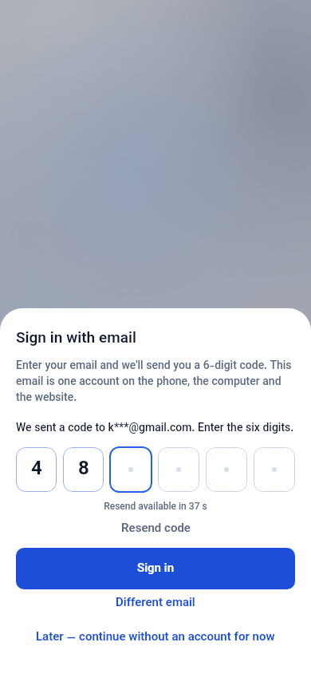

## code-sheet-light-fa

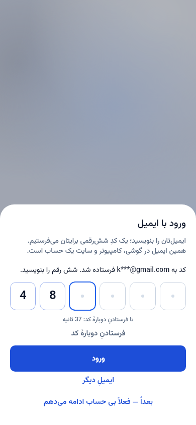

## forgot-dark-en

## forgot-dark-fa

## forgot-light-en

## forgot-light-fa

## join-dark-en

## join-dark-fa

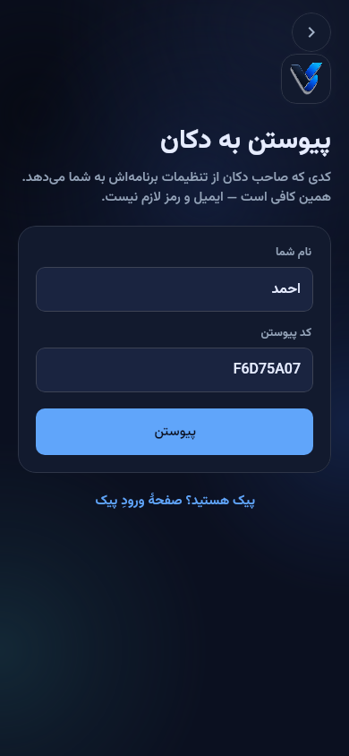

## join-light-en

## join-light-fa

## lock-setup-dark-en

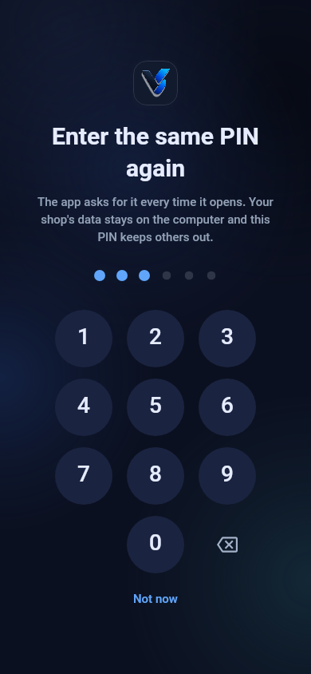

## lock-setup-dark-fa

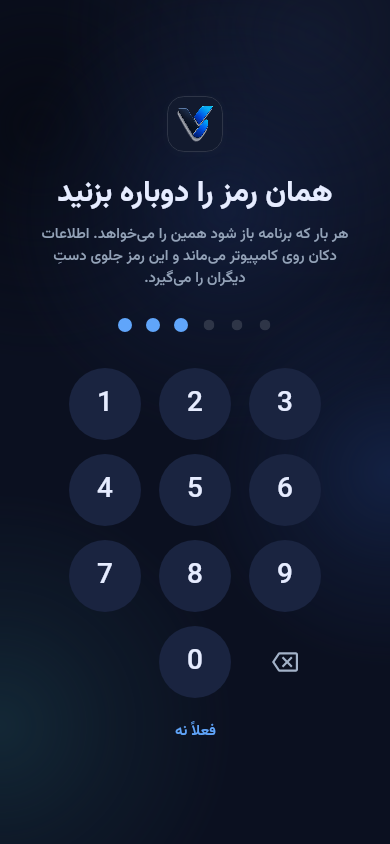

## lock-setup-light-en

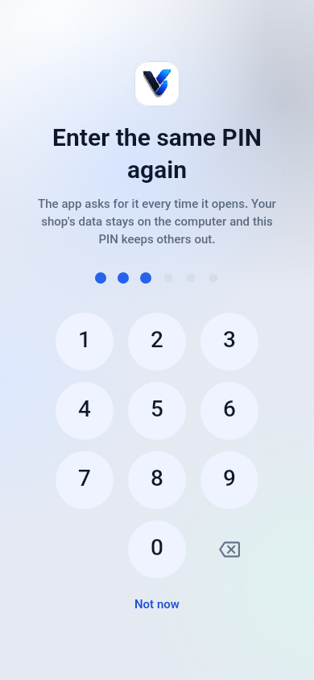

## lock-setup-light-fa

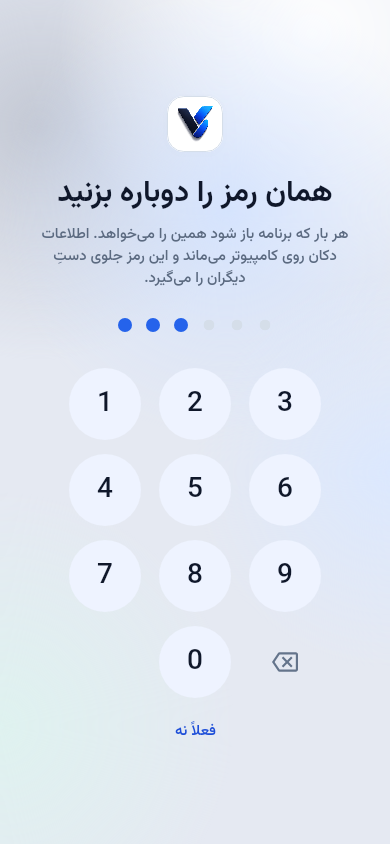

## lock-wrong-dark-en

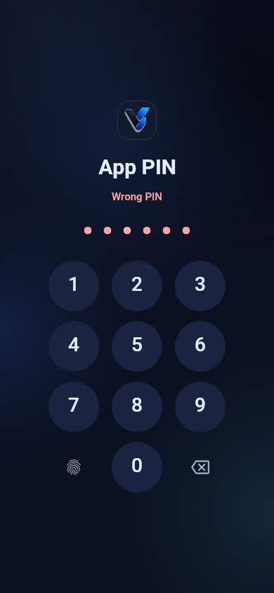

## lock-wrong-dark-fa

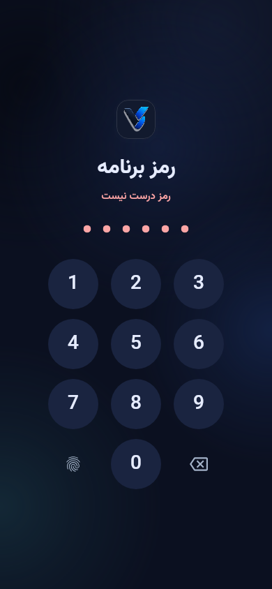

## lock-wrong-light-en

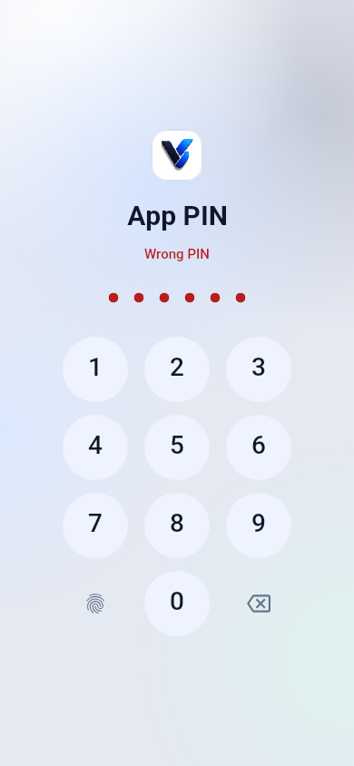

## lock-wrong-light-fa

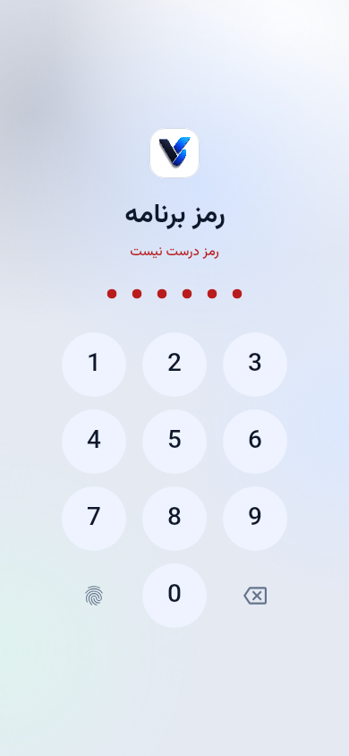

## reauth-dark-en

## reauth-dark-fa

## reauth-light-en

## reauth-light-fa

## reset-code-dark-en

## reset-code-dark-fa

## reset-code-light-en

## reset-code-light-fa

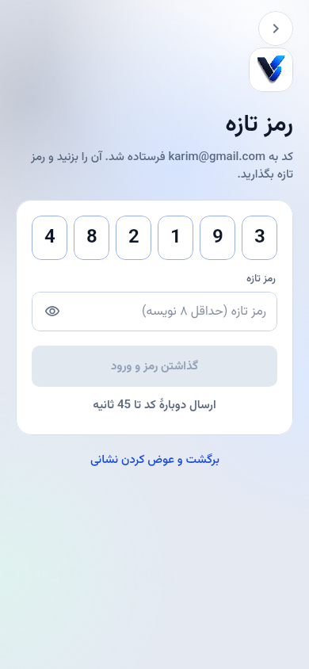

## shop-owner-dark-en

## shop-owner-dark-fa

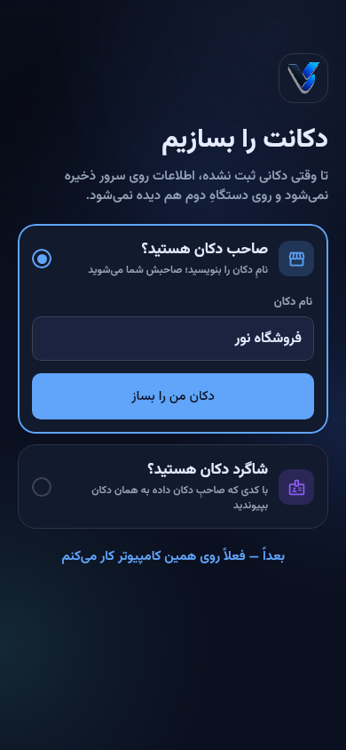

## shop-owner-light-en

## shop-owner-light-fa

## shop-staff-error-dark-en

## shop-staff-error-dark-fa

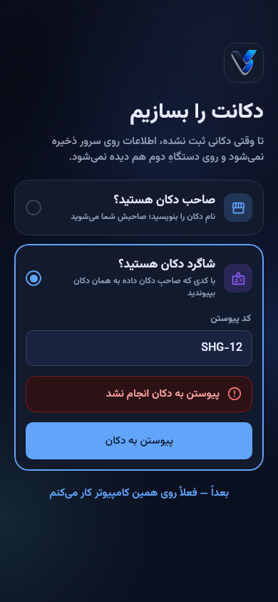

## shop-staff-error-light-en

## shop-staff-error-light-fa

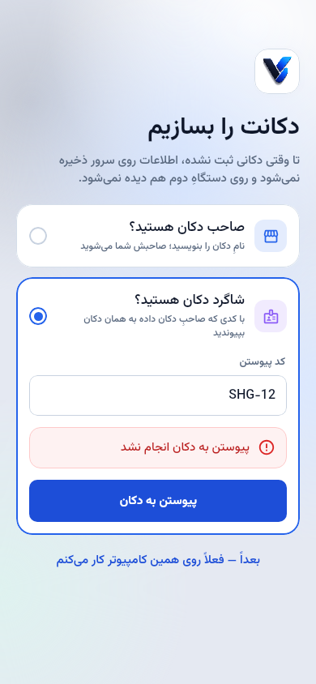

## signin-dark-en

## signin-dark-fa

## signin-error-dark-en

## signin-error-dark-fa

## signin-error-light-en

## signin-error-light-fa

## signin-light-en

## signin-light-fa

## signin-saved-dark-en

## signin-saved-dark-fa

## signin-saved-light-en

## signin-saved-light-fa

## signup-1-dark-en

## signup-1-dark-fa

## signup-1-light-en

## signup-1-light-fa

## signup-2-code-dark-en

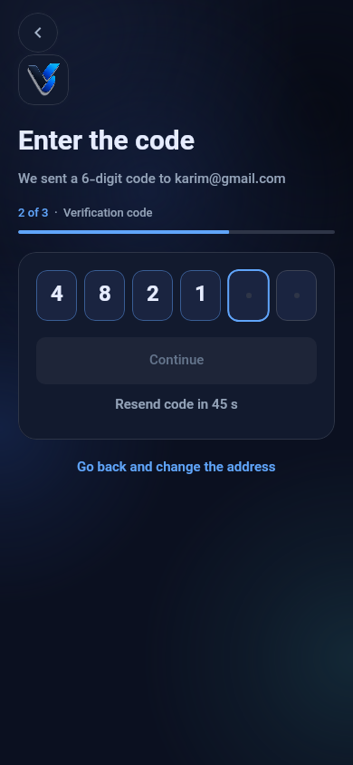

## signup-2-code-dark-fa

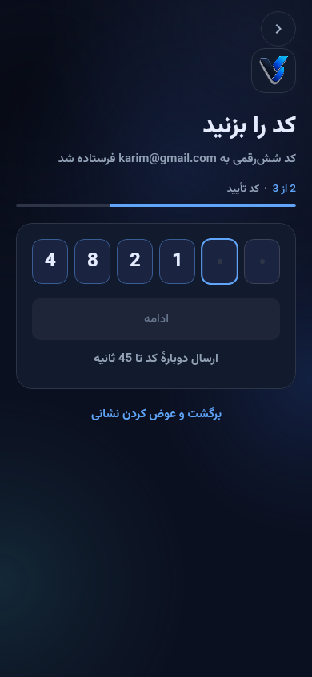

## signup-2-code-light-en

## signup-2-code-light-fa

## signup-3-failed-dark-en

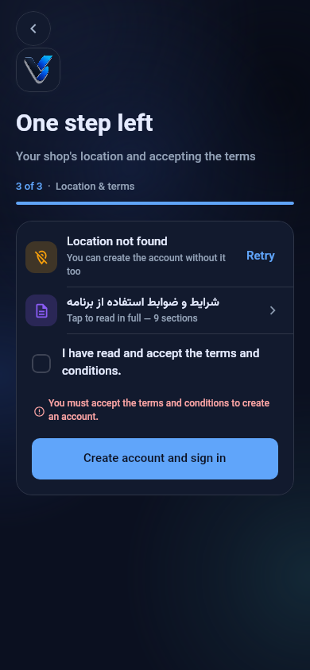

## signup-3-failed-dark-fa

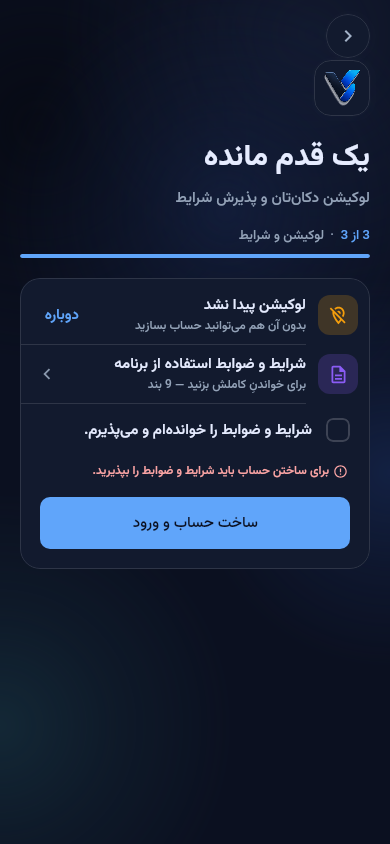

## signup-3-failed-light-en

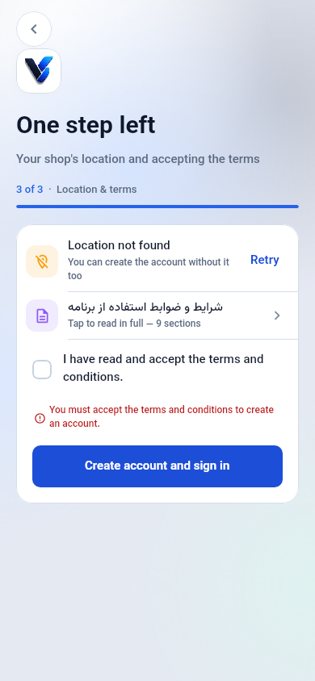

## signup-3-failed-light-fa

## signup-3-found-dark-en

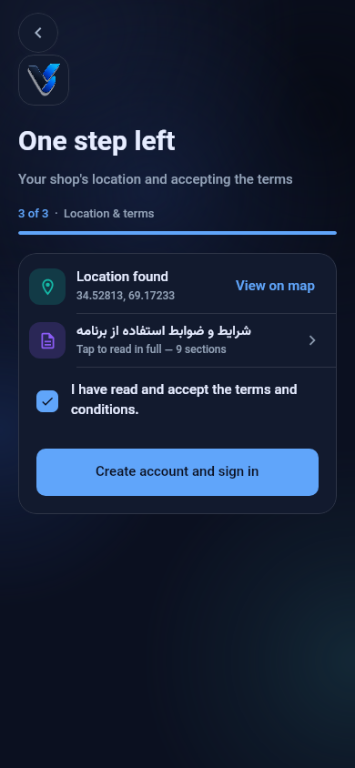

## signup-3-found-dark-fa

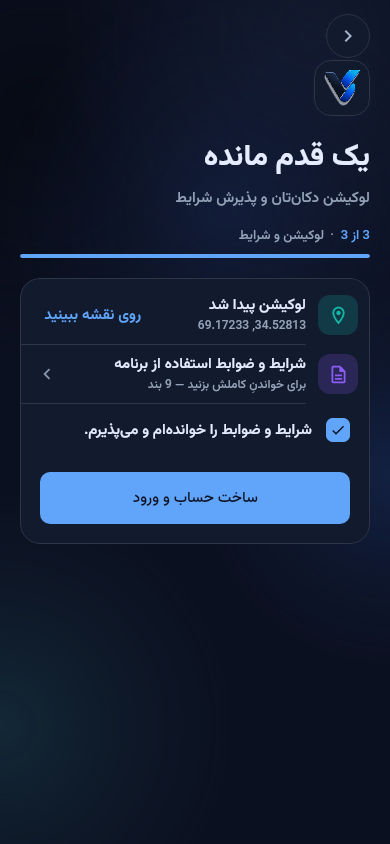

## signup-3-found-light-en

## signup-3-found-light-fa

## terms-dark-en

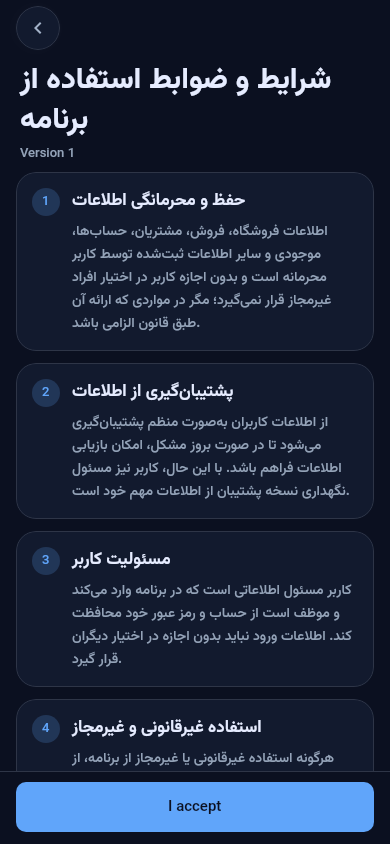

## terms-dark-fa

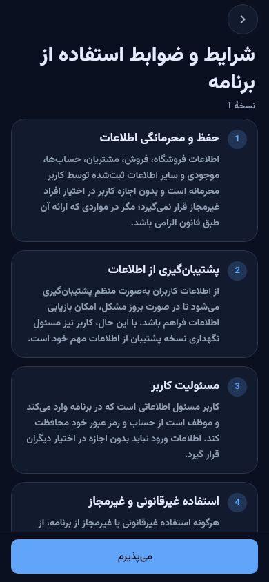

## terms-light-en

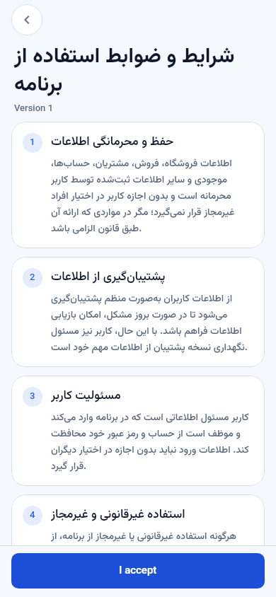

## terms-light-fa

