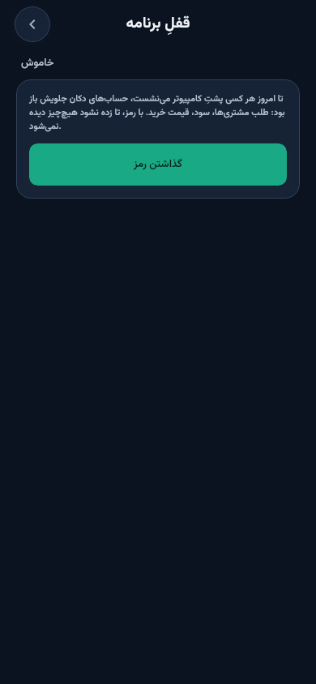
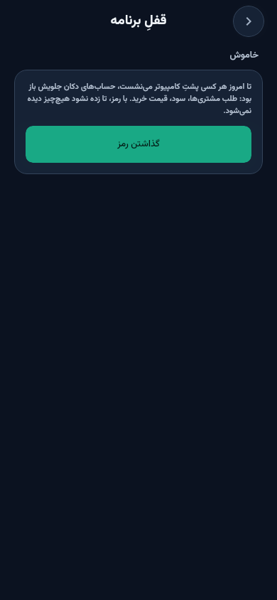
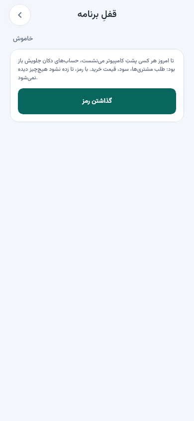
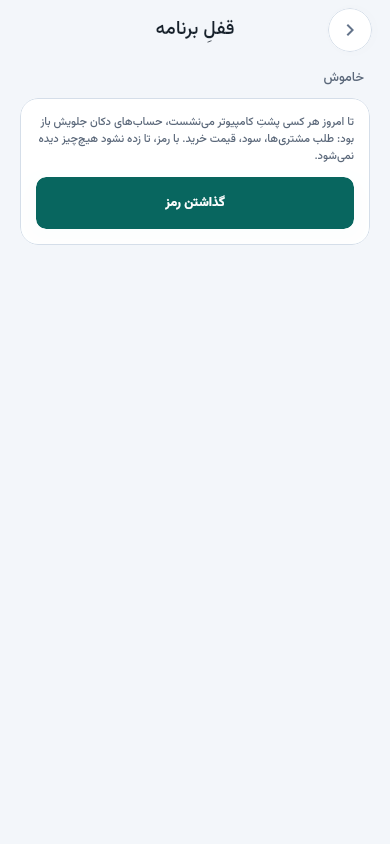
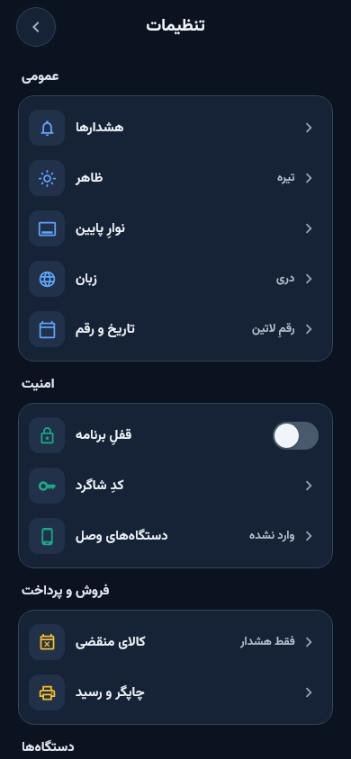
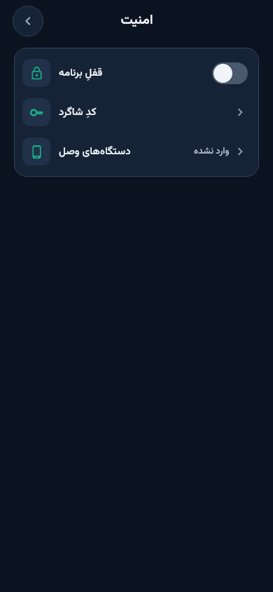
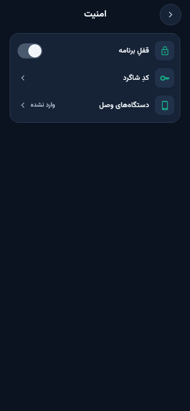
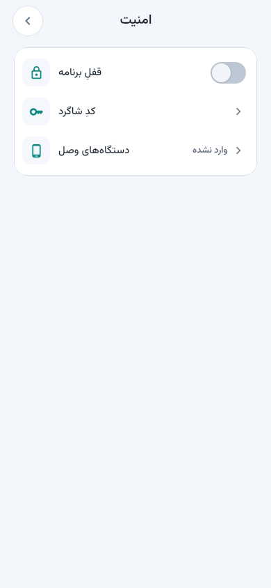
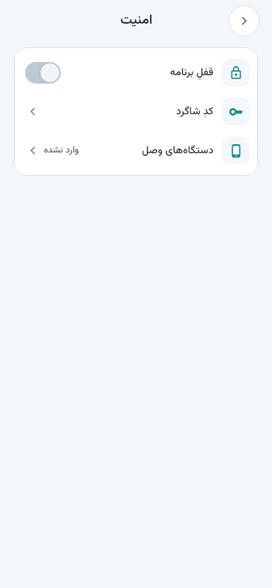

# نسخهٔ ۳ — settings

از `6129e06` (ccr-3a0d593c-ac0jpj-v3-analytics) — دفترِ نمایشی روی نمایشگرِ مجازی؛ اندازهٔ عکس‌ها: 390×844، 1280×800، 1920×1080.

## app-lock-dark-en

## app-lock-dark-fa

## app-lock-light-en

## app-lock-light-fa

## root-dark-en

## root-dark-fa

## root-light-en

## root-light-fa

## security-dark-en

## security-dark-fa

## security-light-en

## security-light-fa

